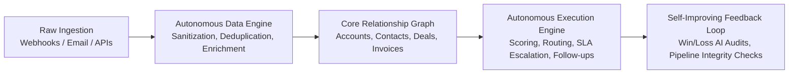
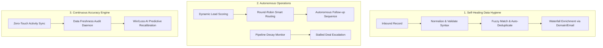
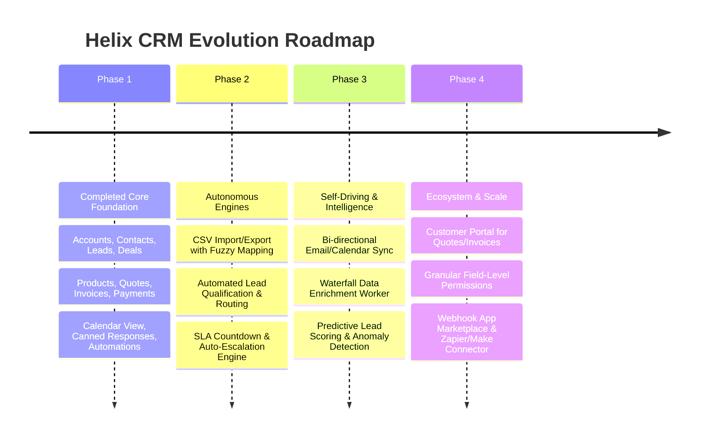

# Global CRM Audit & Autonomous System Specification

## 1. Executive Summary & Market Audit

This comprehensive audit synthesizes architectural and functional benchmarks across leading open-source platforms (**Twenty, EspoCRM, SuiteCRM, Frappe CRM, ERPNext, Dolibarr, Chatwoot, DeskcommCRM**) and premier enterprise SaaS solutions (**Salesforce, HubSpot, Attio, Close**).

### The Evolutionary Paradigm Shift
The CRM industry has completed a generational transition:
1. **First Generation (1995–2010 - SuiteCRM / SugarCRM / Dolibarr lineage):** Static databases of record requiring massive manual data entry, complex forms, and brittle custom scripting.
2. **Second Generation (2010–2022 - HubSpot / EspoCRM / ERPNext / Chatwoot):** Modular, API-first platforms with visual kanban boards, shared omnichannel support inboxes, and basic if-this-then-that rule triggers.
3. **Third Generation (2023–Present - Twenty / Attio / Autonomous AI CRMs):** High-velocity, AI-native operational engines characterized by zero-friction keyboard ergonomics (⌘K), dynamic schema/metadata engines, and **autonomous background agents** that enrich, qualify, heal data, and progress pipelines with minimal human intervention.

---

## 2. Comprehensive Core Modules ("The Clean CRM Standard")

Every modern CRM must execute these nine core modules with precision, dense data presentation, and low-latency interaction:

| Module | Core Purpose | Reference Benchmark | Standard Functions |
| :--- | :--- | :--- | :--- |
| **1. Accounts (Companies)** | B2B Entity 360° Profile | Twenty, EspoCRM | Parent-child hierarchies, industry firmographics, financial rollups, annual revenue, active deals/quotes/invoices, unified activity feed, custom fields, audit diff trail. |
| **2. Contacts (People)** | Individual Stakeholder Management | Twenty, SuiteCRM | Full name, multi-channel communication (email, mobile, direct, LinkedIn), primary account roll-up, job title, department, buying authority tag, communication history. |
| **3. Leads & Conversion** | Inbound/Outbound Qualification | Frappe CRM, SuiteCRM | Lead score (0–100), estimated value, source attribution, qualification status stepper, qualification notes, **1-click conversion** into Account + Contact + Deal. |
| **4. Deals & Pipelines** | Revenue Opportunity Management | Frappe CRM, Twenty | Multi-pipeline support, visual drag-and-drop Kanban, stage probability weighting, expected close dates, automated next-step prompts, won/lost reason analysis. |
| **5. Activities & Calendar** | Scheduling & Task Management | Twenty, EspoCRM | Unified timeline of Tasks, Calls, Meetings, Emails, and Notes. Monthly grid & Agenda chronological list, quick complete toggles, deal close date milestones. |
| **6. Commercial Revenue** | Quotes, Invoices & Payments | Dolibarr, ERPNext | Product catalog (SKU, price, tax rate), quotations with line items, line/order discounts, printable tax invoices, payment recording (wire, credit card, cash), balance tracking. |
| **7. Omnichannel Support** | Shared Customer Inbox | Chatwoot, DeskcommCRM | Multi-channel ticketing (Email, Web Chat, API), SLA due countdowns, status workflow (Open, Pending, Resolved, Closed), public replies vs internal notes, canned responses. |
| **8. Analytics & Reports** | Executive Decision Intelligence | HubSpot, SuiteCRM | Revenue forecast trends, stage conversion funnels, rep leaderboard, top account exposure, lead source ROI, support ticket volume & SLA breach metrics. |
| **9. Platform & Workspace** | Governance, Security & Schema | EspoCRM, Twenty | Row-level tenant isolation, RBAC permissions (Admin, Manager, Rep), custom field schema builder, immutable audit logging, RFC 4180 CSV import/export. |

---

## 3. Deep-Dive Functional Breakdown: How Every Function Works

### 3.1. Accounts & Company 360° Management
- **Hierarchical Company Roll-ups:** Support parent-subsidiary relationships. Subsidiary deals roll up to parent accounts for total enterprise customer value (LTV).
- **Domain-Based Auto-Association:** When a contact or email arrives with `@acme.com`, the system automatically attaches the contact and conversation to the existing Acme Corporation account.
- **Aggregated Commercial Metrics:** Real-time calculation of `TotalPipelineValue`, `TotalWonRevenue`, `TotalUnpaidInvoices`, and `HealthScore`.
- **Field Change Audit History:** Granular auditing capturing the exact timestamp, actor ID, old value, and new value for every account edit.

### 3.2. Leads Lifecycle & Conversion Engine
- **Multi-Factor Lead Scoring:** Score from 0 to 100 based on firmographics (company size, industry), completeness (verified work email, phone), and activity engagement (replies, web visits).
- **Atomic 1-Click Conversion Transaction:** In an isolated database transaction, convert a qualified lead into:
  1. A new or linked existing Account.
  2. A new Contact linked to that Account.
  3. A new Deal placed in the first stage of the default Pipeline.
  4. Migration of all past activities, notes, and emails to the newly created entities.
  5. Lead status stamped as `Converted` with immutable pointer to the converted IDs.

### 3.3. Configurable Deals & Sales Pipelines
- **Pipeline Architecture:** Multiple pipelines per organization (e.g., *Direct Sales*, *Partnership Distribution*, *Customer Renewals*).
- **Dynamic Probability & Weighted Forecast:** Each pipeline stage specifies a win probability (e.g., Discovery = 20%, Proposal = 60%, Negotiation = 80%). The weighted forecast automatically evaluates `Amount * Probability`.
- **Stage Movement Guardrails:** Moving a deal to `Closed Lost` mandates a structured `LostReason` (e.g., Price, Competitor, Feature Gap, Budget Freeze). Moving to `Closed Won` triggers automated downstream onboarding tasks.

### 3.4. Commercial Invoicing & Payment Workflow (ERPNext / Dolibarr Standard)
- **Quote $\to$ Invoice Conversion:** When a quotation is marked `Accepted`, a single click converts all line items, agreed discounts, and tax rates into a formal tax invoice with an auto-incrementing serial number (`INV-YYYY-XXXX`).
- **Payment Reconciliation:** Record partial or full payments with transaction references (Wire transfer, ACH, Stripe, Check). The system updates `AmountPaid` and `BalanceDue`. When `BalanceDue == 0`, status changes automatically to `Paid`.
- **Printable Tax Invoice Layout:** CSS `@media print` optimized documents adhering to international invoicing standards (issuer VAT/Tax ID, line breakdown, payment terms).

### 3.5. Omnichannel Ticket Inbox & Canned Responses (Chatwoot Standard)
- **Unified Timeline:** Conversations treat customer replies, agent responses, and team internal notes on a unified chronological activity thread.
- **Public Reply vs Internal Note:** Reps can toggle between public messages (sent to customer) and internal notes (highlighted yellow, visible only to internal team).
- **Canned Responses / Macros:** Support for slash-shortcut templates (e.g., `/intro`, `/pricing`, `/refund`, `/resolved`). Support reps can select pre-approved responses to ensure consistent communication and sub-minute response times.
- **SLA Breach Monitoring:** Automatic calculation of SLA response targets based on priority (Urgent = 4h, High = 24h, Normal = 72h). Dynamic color-coded warnings (On Track, Due Soon, Overdue).

---

## 4. Autonomous "Self-Driving" CRM Capabilities

To elevate a CRM from a passive registry into an **autonomous system that runs on its own**, the platform must deploy continuous background agents executing the following automated workflows:

### 4.1. Automated Data Enrichment & Waterfall Ingestion
- **How it functions:** When an account or contact is created with only a name or domain (e.g., `stripe.com`), a background worker queries enrichment endpoints (Clearbit, Apollo, PeopleDataLabs, or LLM scrapers).
- **Autonomous Action:** Automatically fills company logo, employee range, estimated revenue, LinkedIn company profile, headquarters city/country, and industry classification without user input.

### 4.2. Self-Healing Data Hygiene & Intelligent Deduplication
- **How it functions:** A background daemon runs continuously over newly created and modified records:
  1. **Syntax Normalization:** Normalizes phone numbers to E.164 international standard (`+14155550100`), trims whitespace, capitalizes names properly, and detects common domain typos (e.g., `@gmial.com` $\to$ `@gmail.com`).
  2. **Fuzzy & Probabilistic Matching:** Uses Levenshtein and Jaro-Winkler distance metrics on company names and email prefixes (e.g., matching "Acme Corp" with "Acme Corporation").
  3. **Automated Survivorship Merging:** Automatically merges duplicates where high confidence (>95%) is detected, retaining the most recent active communication while preserving older historical notes.

### 4.3. Autonomous Lead Routing & Qualification
- **How it functions:** Inbound leads from website forms, webhooks, or emails are instantly processed:
  1. Evaluated against ideal customer profile (ICP) criteria.
  2. Scored dynamically based on title seniority, company size, and budget indicators.
  3. Distributed via weighted round-robin or territory-matching rules to available sales reps.
  4. Automatically dispatches a personalized welcome confirmation email if no human acts within 5 minutes.

### 4.4. Pipeline Velocity & Stagnation Self-Healing
- **How it functions:** In sales pipelines, deals often get forgotten and linger in stages indefinitely.
- **Autonomous Action:** If a deal spends more than 14 days in a stage without logged activities, the autonomous engine:
  1. Lowers the probability rating by 15%.
  2. Generates an urgent task for the deal owner: *"Deal stagnant: Confirm next step or mark lost"*.
  3. Sends a notification to the sales manager if no response occurs within 48 hours.

### 4.5. Autonomous Support Triage & SLA Auto-Escalation
- **How it functions:** When an incoming support ticket arrives:
  1. The engine performs sentiment analysis (e.g., detecting frustrated keywords or urgent billing threats).
  2. Sets priority to `Urgent` automatically if negative sentiment or contract cancellation risk is detected.
  3. If an SLA reaches 75% elapsed time without response, the system automatically alerts the team lead and reassigns to an active agent.

---

## 5. Continuous Improvement & Accuracy Engines

A CRM becomes exponentially more valuable when its accuracy increases over time rather than decaying through data entropy.

### 5.1. Zero-Touch Activity Logging
- **The Problem:** 70% of CRM inaccuracies stem from sales reps forgetting to log calls, emails, and meetings.
- **The Solution:** Continuous bi-directional integration with Google Workspace / Microsoft 365. Emails and calendar events matching CRM contact addresses are auto-indexed into the contact's timeline in the background.

### 5.2. Automated Win/Loss Intelligence & Predictive Recalibration
- **How it functions:** The system analyzes patterns in won vs lost deals over rolling 90-day windows.
- **Self-Improving Action:** If deals from `Source = LinkedIn Ads` in `Industry = Healthcare` convert at 45% while `Source = Cold Outreach` converts at 8%, the scoring algorithm automatically increases weightings for healthcare leads and decreases scores for cold outreach, continuously refining forecast precision.

### 5.3. Record Freshness & Data Decay Auditing
- **How it functions:** Contact data decays at roughly 30% per year due to employee turnover.
- **Autonomous Audit:** A weekly background daemon flags contacts with no communication in 180 days with a `Stale` indicator. If an outbound email bounces, the contact status is immediately flagged as `Invalid Email`, and a task is generated to find the replacement contact.

### 5.4. Pipeline Integrity Anomaly Detector
- **How it functions:** Machine learning checks for human estimation errors:
  - Deals with `ExpectedCloseDate` in the past that are still marked `Open`.
  - Deals entered with anomalous amounts (e.g., $1,000,000 entered by a junior rep when average deal size is $15,000).
  - Deals marked `Closed Won` without an associated Account or Contact.
- **Autonomous Action:** Flags discrepancies on the dashboard and prompts the user for 1-click rectification.

---

## 6. Target Technology Stack & Implementation Mapping

| Layer | Selected Technology | Architectural Advantage |
| :--- | :--- | :--- |
| **Backend Framework** | **.NET 10 (C#)** | High-throughput asynchronous performance, strongly typed enterprise domain modeling, native OpenAPI/Scalar documentation, battle-tested concurrency. |
| **Database & ORM** | **PostgreSQL 17 + EF Core 10** | Robust JSONB support for dynamic custom fields, ACID-compliant transactions for commercial quotes/invoices, row-level multi-tenancy query filters. |
| **Frontend Framework** | **Next.js 16 (App Router) + React 19** | Fast server components, responsive client interactivity, SWR optimistic UI updates, first-party cookie session proxying. |
| **Styling & Design System** | **Tailwind CSS + Radix UI Primitives** | Token-driven Notion/Twenty-style clean aesthetic, native light and dark mode, accessible modal dialogs, dense high-productivity data tables. |
| **Background Automation** | **Hosted Services / Outbox Daemon** | Asynchronous execution of automation rules, SLA monitors, calendar indexing, and deduplication scans without blocking HTTP threads. |

---

## 7. Strategic Feature Roadmap

